  <picture>
    <source media="(prefers-color-scheme: dark)" srcset="assets/banner-dark.svg">
    
  </picture>

  <b>Agentic CAD üzerine Türkçe topluluk.</b> 
  Soru sor, projeni paylaş, lige katıl, yayınlara soru gönder. 
  📺 <b>Her çarşamba 21.00</b> (TSİ) <a href="https://www.youtube.com/channel/UCj06nxan1j_9dfTbJUVrRVQ">YouTube'da canlı yayın</a> · <a href="https://github.com/TurkisiEngineering/turkisi-cad-hub/discussions/1">yayın serisi</a> 
  <i>Ölçmeden onay yok. — KUMPAS</i>

  <a href="https://github.com/TurkisiEngineering/turkisi-cad-hub/discussions"><b>💬 Topluluğa gir</b></a> ·
  <a href="https://github.com/TurkisiEngineering/turkisi-cad-hub/discussions/new?category=soru-cevap">🙋 Soru sor</a> ·
  <a href="https://github.com/TurkisiEngineering/turkisi-cad-hub/discussions/new?category=projelerimiz">🛠️ Proje paylaş</a> ·
  <a href="https://github.com/TurkisiEngineering/turkisi-cad">🏁 Agentic CAD Ligi</a> ·
  <a href="https://www.youtube.com/channel/UCj06nxan1j_9dfTbJUVrRVQ">📺 YouTube</a>

---

## Bu hub ne?

Türkişi Engineering YouTube kanalının agentic CAD topluluğu burada yaşıyor. Kod yazmayan izleyici de, kendi harness'ını kuran mühendis de aynı yerde konuşuyor:

- AI agent'larla CAD modelleme (Siemens NX, SolidWorks, build123d, FreeCAD …)
- CAD için MCP sunucuları, skill'ler, prompt ve workflow'lar
- Scan / STL → parametrik CAD, tersine mühendislik
- Agentic CAD benchmark'ları ve **Türkişi Agentic CAD Ligi**

Bu repoda kod yok. Her şey **[Discussions](https://github.com/TurkisiEngineering/turkisi-cad-hub/discussions)** sekmesinde.

## Nasıl katılırım?

1. Ücretsiz bir [GitHub hesabı](https://github.com/signup) aç. Adım adım anlatım: [GitHub'a ilk adım](https://github.com/TurkisiEngineering/turkisi-cad-hub/discussions/categories/duyurular).
2. **[Merhaba](https://github.com/TurkisiEngineering/turkisi-cad-hub/discussions/categories/merhaba)** kategorisinde kendini kısaca anlat.
3. Bildirim almak için sağ üstten **Watch → Custom → Discussions** seç.

## Kategoriler

| | Kategori | Ne için? |
|---|---|---|
| 📣 | [Duyurular](https://github.com/TurkisiEngineering/turkisi-cad-hub/discussions/categories/duyurular) | Yayın saatleri, yeni videolar, lig güncellemeleri |
| 👋 | [Merhaba](https://github.com/TurkisiEngineering/turkisi-cad-hub/discussions/categories/merhaba) | Kimsin, hangi CAD aracı, hangi agent |
| 💬 | [Muhabbet](https://github.com/TurkisiEngineering/turkisi-cad-hub/discussions/categories/muhabbet) | Serbest sohbet, haberler, fikirler |
| 🙋 | [Soru-Cevap](https://github.com/TurkisiEngineering/turkisi-cad-hub/discussions/categories/soru-cevap) | Takıldığın yer, hata, kurulum desteği |
| 🛠️ | [Projelerimiz](https://github.com/TurkisiEngineering/turkisi-cad-hub/discussions/categories/projelerimiz) | Topluluğun projeleri: parçalar, harness'lar, ölçülü sonuçlar |
| 🏁 | [Lig](https://github.com/TurkisiEngineering/turkisi-cad-hub/discussions/categories/lig) | Agentic CAD Ligi denemeleri, skorlar, haftalık challenge |
| 🧩 | [Workflow & Prompt](https://github.com/TurkisiEngineering/turkisi-cad-hub/discussions/categories/workflow-prompt) | Skill, prompt, MCP ayarları, başarısız denemeler |
| 📺 | [Yayın Soruları](https://github.com/TurkisiEngineering/turkisi-cad-hub/discussions/categories/yayın-soruları) | Canlı yayında cevaplanacak sorular |
| 🗳️ | [Anketler](https://github.com/TurkisiEngineering/turkisi-cad-hub/discussions/categories/anketler) | Sonraki yayın / içerik oylamaları |
| 💼 | [Kariyer & Freelance](https://github.com/TurkisiEngineering/turkisi-cad-hub/discussions/categories/kariyer-freelance) | CAD / agentic CAD iş ilanları ve ortak arayışı |

## Ekip

<!-- MEMBERS:START -->
<table><tr><td align="center" width="160"><a href="https://github.com/TurkisiEngineering"> <b>Türkişi Engineering</b></a> Organizasyon</td><td align="center" width="160"><a href="https://github.com/mikbalarikan"> <b>Muhammed İkbal Arıkan</b></a> Kurucu ortak · moderatör</td><td align="center" width="160"><a href="https://github.com/Olmustur"> <b>Ahmet Talha Olmuştur</b></a> Kurucu ortak · moderatör</td></tr></table>
<!-- MEMBERS:END -->

Topluluğa katkı yapanlar zamanla buraya eklenir. Bkz. [CONTRIBUTING.md](CONTRIBUTING.md).

## Projeler

Ekip üyelerinin `turkisi-community` topic'i taşıyan tüm açık repoları aşağıda listelenir. Liste her gün otomatik güncellenir.

<!-- BRIDGE:START -->
_Henüz listelenecek proje yok._

0 proje · tüm liste: [topics/turkisi-community](https://github.com/topics/turkisi-community)
<!-- BRIDGE:END -->

Kendi reponu bu listeye eklemek istiyorsan **Projelerimiz** kategorisinde paylaş. Düzenli katkı yapan üyeler `community/members.yml` dosyasına eklenir.

## Kurallar

Kısaca: saygılı ol, gizli/NDA'lı müşteri dosyası paylaşma, reklam yapma, soruna log ve ekran görüntüsü ekle. Tamamı: [CODE_OF_CONDUCT.md](CODE_OF_CONDUCT.md).

---

<b>English</b>

Türkişi CAD Hub is the community home of the Türkişi Engineering YouTube channel, focused on **agentic CAD**: AI agents driving real CAD tools, CAD MCP servers, scan→CAD, and agentic CAD benchmarks. Main language is Turkish; English posts are welcome. Everything happens in [Discussions](https://github.com/TurkisiEngineering/turkisi-cad-hub/discussions).

