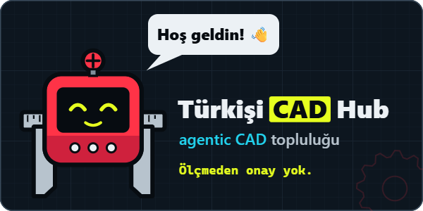

Türkişi Engineering kanalının **agentic CAD** topluluğuna hoş geldin. 📏

Burada AI agent'larla gerçek CAD araçlarını (Siemens NX, SolidWorks, build123d, FreeCAD …) kullanmayı konuşuyor, birbirimize yardım ediyor ve sonuçlarımızı ölçerek paylaşıyoruz.

### İlk 3 adım
1. **[Tanışma](https://github.com/TurkisiEngineering/turkisi-cad-hub/discussions/categories/tanisma)** kategorisinde kendini kısaca tanıt.
2. Bildirim almak için sağ üstten **Watch → Custom → Discussions** seç.
3. Bir sorun varsa **[Soru-Cevap](https://github.com/TurkisiEngineering/turkisi-cad-hub/discussions/categories/soru-cevap)**, bir şey ürettiysen **[Projelerimiz](https://github.com/TurkisiEngineering/turkisi-cad-hub/discussions/categories/projelerimiz)**.

### Nereye ne yazılır?
| Ne paylaşacaksın? | Kategori |
|---|---|
| Takıldığın bir hata / kurulum | 🙋 Soru-Cevap |
| Kendi parçan, harness'ın, sonucun | 🛠️ Projelerimiz |
| Lig denemesi, skor, challenge | 🏁 Lig |
| Prompt, skill, MCP ayarı, başarısız deneme | 🧩 Workflow & Prompt |
| Canlı yayında sorulacak soru | 📺 Yayın Soruları |
| Serbest sohbet, haber, fikir | 💬 Muhabbet |
| İş ilanı / freelance / ortak arayışı | 💼 İş & Freelance |

### Canlı yayınlar
Her yayından önce **📺 Yayın Soruları** kategorisinde sabitlenmiş bir başlık açıyoruz. Soruların yayında ekranda cevaplanıyor. Yayın sonrası kayıt ve dosyalar aynı başlığa ekleniyor.

### Diğer projelerimiz
Ekibin agentic CAD projeleri hub'ın ana sayfasında **[Projeler](https://github.com/TurkisiEngineering/turkisi-cad-hub#projeler)** bölümünde. Liste otomatik güncelleniyor.

### Kurallar (kısa)
Saygılı ol · NDA'lı/paylaşma hakkın olmayan dosya paylaşma · reklam yok · soruna log ve ortam bilgisi ekle. Tamamı: [CODE_OF_CONDUCT.md](https://github.com/TurkisiEngineering/turkisi-cad-hub/blob/main/CODE_OF_CONDUCT.md)

*Ölçmeden onay yok.* — KUMPAS 🤖
