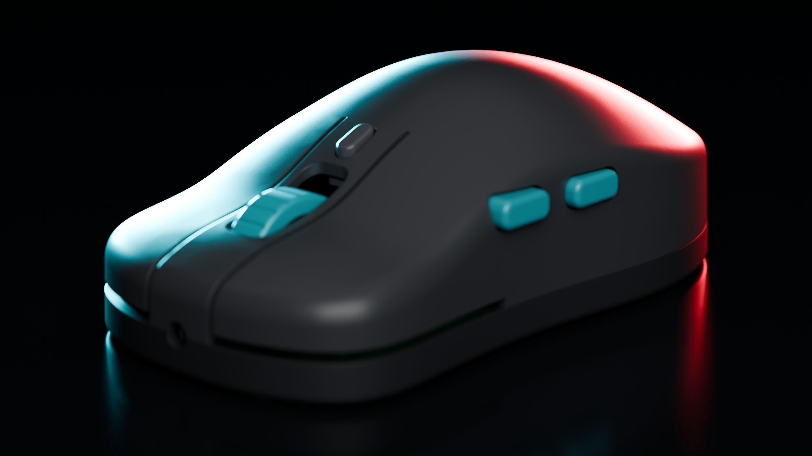
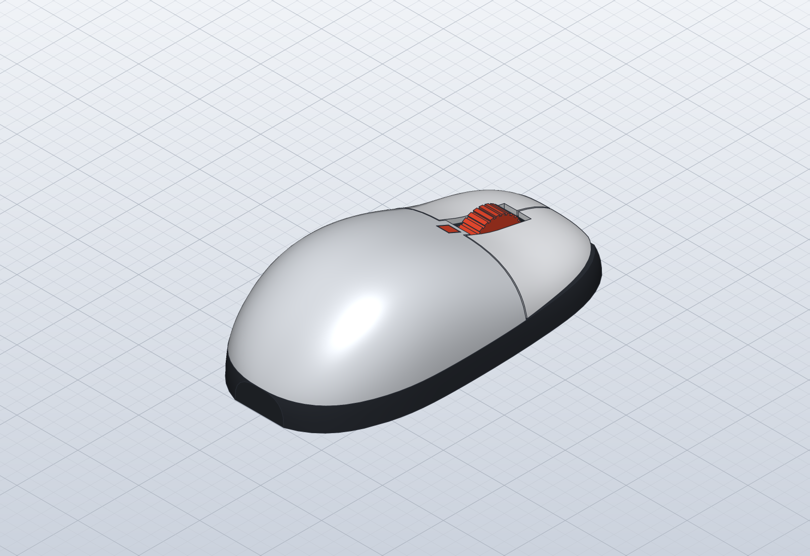
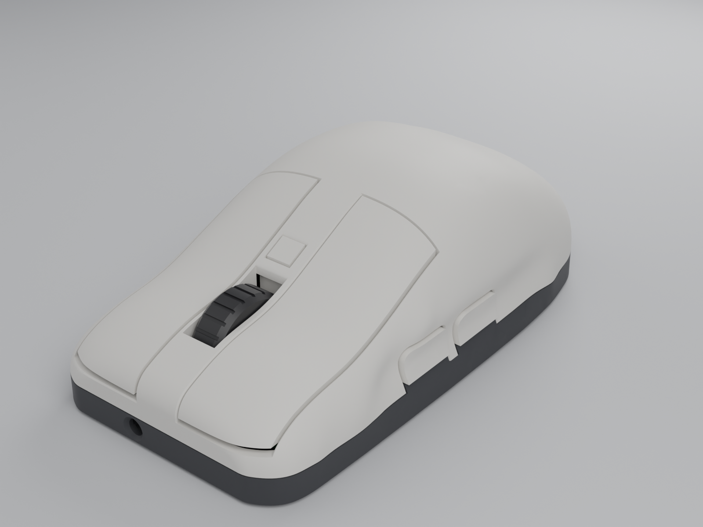
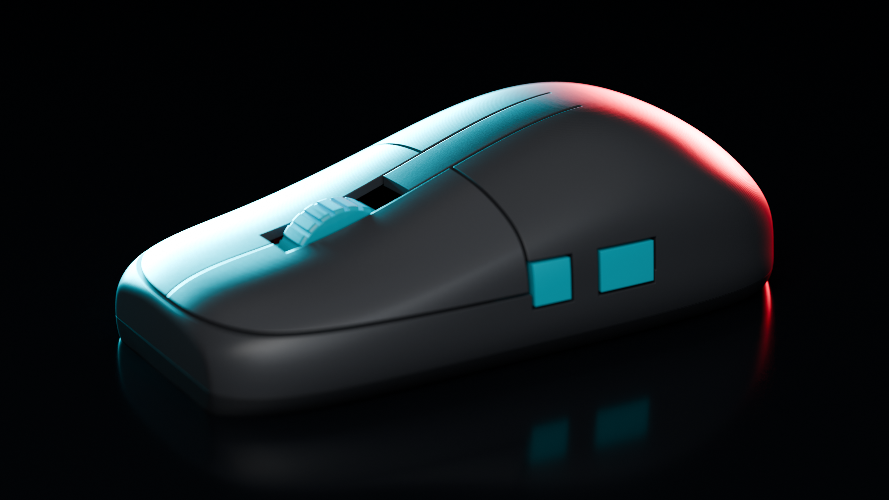

# 25 Kasım 2026 · Ajanlar Yarışıyor: SolidWorks MCP vs NX MCP

📺 Yayın: https://youtu.be/p9tGvunJSg8 · 💬 Duyuru ve sorular: [#2](https://github.com/TurkisiEngineering/turkisi-cad-hub/discussions/2)

Ajanlar aynı PCB STEP dosyasından **3B yazıcıyla basılabilir DIY oyuncu faresi kabuğu** tasarlıyor:
üst kabuk, alt kabuk, tuşlar, tekerlek. Yöntem ve prompt serbest, girdi herkes için aynı.

## Girdi

[`girdi/mouse_pcb.step`](girdi/mouse_pcb.step) · SHA-256 `da66ded68762658dcbcef532b2fd1c550f8a20c2086669cb0d8221ffd974f439`
Görev metni ve kriterler: [`girdi/GOREV.md`](girdi/GOREV.md)

Kart 49.8 × 61.7 × 1.6 mm: 6 × Omron D2F mikro anahtar, PMW3360 optik sensör, EC10E tekerlek encoder'ı, RP2040,
4 × M2 delik, 4 pin USB başlığı. D2F tuşlar, sensör gövdesi ve encoder yaklaşık (yer kaplama) gövdeler; ölçüleri
footprint'ten, yükseklikleri tahmin. Gerçek parçayla basacaksanız bu üç ölçüyü kumpasla doğrulayın.

## Sonuçlar

| Klasör | Ne | Araç zinciri | Durum |
|---|---|---|---|
| [`neon-mouse/`](neon-mouse/) | Yayın öncesi örnek fare | Antigravity · Neon modeli + bizim NX harness'ımız (NX 2206, NXOpen journal) | ✅ hazır |
| `nx-mcp/` | Yayındaki NX ajanı | NX MCP | ⏳ yayında |
| [`solidcraft-contabo/`](solidcraft-contabo/) | Açık kaynak CAD ajanı | SolidCraft 0.49.1 (headless), Contabo Linux VPS | ✅ hazır |
| [`build123d/`](build123d/) | Claude Code çoklu ajan, NX'siz | Claude Code (Opus 5.5, ultracode) + build123d 0.11.1 (OpenCascade) | ⚠️ teslim, 6 açık bulgu |
| [`nx-claude-code/`](nx-claude-code/) | Claude Code, temiz NX oturumu | Claude Code (Opus 5.5) + bizim NX harness'ımız (NX 2206, NXOpen journal, WAVE kontrol parçası) | ✅ teslim, ~2 sa |
| `solidworks-mcp/` | Konuğumuz Ahmet Talha Olmuştur | SolidWorks MCP | ⏳ yayında |

Kıyas kriterleri: basılabilirlik · tuş/tekerlek uyumu · sensör açıklığı · montaj/vida · ergonomi · süre.

## Neon Mouse içeriği

~116 × 63.6 × 39.4 mm, 7 parça: alt şasi, üst kabuk, tekerlek, DPI tuşu, iki başparmak tuşu, PTFE ayaklar.

| Klasör | İçerik |
|---|---|
| [`plan.md`](neon-mouse/plan.md) | Mühendislik planı ve doğrulama raporu (PCB arayüz haritası, parça listesi) |
| [`step/`](neon-mouse/step/) | Parça STEP'leri, `mouse_assembly_full.step` (PCB dahil montaj), `mouse_mechanical_only.step` |
| [`stl/`](neon-mouse/stl/) | Baskı için parça başına STL |
| [`prt/`](neon-mouse/prt/) | NX 2206 parça ve montaj dosyaları (`mouse_asm.prt`) |
| [`views/`](neon-mouse/views/), [`views_hq/`](neon-mouse/views_hq/) | Renderlar: iso, üst, yan, alt, PCB röntgen, patlatılmış, neon |
| [`scripts/`](neon-mouse/scripts/) | Modeli üreten NXOpen journal (`build_mouse.py`), girişim kontrolü, render ve STL betikleri |
| `result.json`, `step_gate.json`, `pcb_asm_result.json` | NX gövde kontrolü, STEP doğrulaması, PCB montaj sonucu |

Betiklerdeki mutlak Windows yolları bizim makinemize ait; kendi makinenizde çalıştırırken değiştirin.

## SolidCraft (Contabo) içeriği

120 × 64 × 37.6 mm, 8 baskı parçası: alt kabuk, üst kabuk, sol/sağ tuş, DPI tuşu, iki başparmak tuşu, tekerlek
(+ Ø2 çelik pim). Tasarım notları, varsayımlar, malzeme listesi ve baskı ayarları:
[`DESIGN_NOTES.md`](solidcraft-contabo/DESIGN_NOTES.md) (İngilizce, ajanın kendi raporu).

| Dosya / klasör | İçerik |
|---|---|
| `mouse_assembly.step`, `mouse_assembly_with_pcb.step` | STEP montajı (9 adlı parça), PCB'li hali |
| [`stl/`](solidcraft-contabo/stl/) | Parça başına STL, baskı yönünde, z = 0'da |
| [`renders/`](solidcraft-contabo/renders/) | iso, üst, sol, ön, arka, patlatılmış, orta kesit, röntgen |
| `mouse_shell.sc` | SolidCraft tasarım dosyası (parametrik geçmiş) |
| [`src/`](solidcraft-contabo/src/) | Modeli baştan üreten betik (`build_mouse.py` → 306 komutluk `build_mouse.json`) ve QA betikleri |
| `build_report.txt`, `qa_report.json`, `SHA256SUMS.txt` | SolidCraft yapım raporu, bağımsız QA (build123d + trimesh), dosya özetleri |

Betiklerdeki `/root/hub/...` yolları bizim sunucumuza ait; kendi ortamınızda değiştirin.

## build123d (Claude Code) içeriği

120 × 63.5 × 39.9 mm, 10 parça: alt kabuk, üst kabuk, sol/sağ tuş (PETG yaprak menteşe), tekerlek, tekerlek yatağı,
DPI tuşu, iki başparmak tuşu (dirsekli kol) ve Ø2 çelik pim. Bütün iş Python'da (build123d). Claude Code işi
paralel alt ajanlara böldü: kart okuma, ortak yerleşim, 5 parça paketi, montaj, bağımsız inceleme, düzeltme
ve render. Süre yaklaşık 4 sa 45 dk. Bağımsız incelemede 6 engelleyici bulgu açık kaldı; en önemlisi ana tuşların
takılabilmesi. Ayrıntılar ve ölçüm tablosu: [`build123d/README.md`](build123d/README.md),
[`CHECKS.md`](build123d/CHECKS.md).

| Dosya / klasör | İçerik |
|---|---|
| `mouse_assembly_step.zip`, `parts_step.zip` | STEP montajı (PCB dahil) ve parça STEP'leri, zip içinde (açılmış montaj 130 MB) |
| [`STL/`](build123d/STL/) | Parça başına STL, baskı yönünde |
| [`renders/`](build123d/renders/) | hero, üst, yan, alt, patlatılmış, kesit |
| [`src/`](build123d/src/) | Ortak yerleşim (`master.py`), parça, montaj ve inceleme betikleri |

## NX (Claude Code) içeriği

117.0 × 62.9 × 36.8 mm, 7 baskı parçası: alt kabuk, üst kabuk, sol/sağ tuş (esnek dil, M2×5), tekerlek, iki yan tuş
(Ø1.75 filament pim menteşe) + Ø2 çelik pim. Aynı görev, sıfırdan ve tek bir Claude Code oturumunda yerel NX 2206 ile
kuruldu: kontrol parçası (`mouse_ctrl.prt`, ana ifadeler + dış deri), WAVE bağlantılarıyla parçalar, üretim montajı.
Parçaların hepsi geçmişli ve parametrik. Süre yaklaşık 2 saat (bir çökme ve yeniden başlatma dahil). Nub–plunger boşlukları
0.20 mm, lens düzlemi yüzeye 2.40 mm, montajda yalnız kasıtlı pim pres geçmesi örtüşüyor. Fiziksel baskı denenmedi.
Ayrıntılar ve açık noktalar: [`nx-claude-code/README.md`](nx-claude-code/README.md), [`CHECKS.md`](nx-claude-code/CHECKS.md).

| Dosya / klasör | İçerik |
|---|---|
| `mouse_assembly_step.zip` | STEP montajı (PCB dahil), zip içinde |
| `NX/nx_prt.zip` | NX 2206 `.prt` dosyaları: kontrol parçası, tasarım ve üretim montajı, parçalar |
| [`STL/`](nx-claude-code/STL/) | Parça başına STL, baskı yönünde |
| [`renders/`](nx-claude-code/renders/), [`renders/blender/`](nx-claude-code/renders/blender/) | NX ara render'ları, Blender stüdyo render'ları |
| [`NX/journals/`](nx-claude-code/NX/journals/), [`NX/results/`](nx-claude-code/NX/results/) | Modeli baştan üreten journal'lar (`j1_ctrl` … `j7_regen`) ve ölçüm sonuçları |

