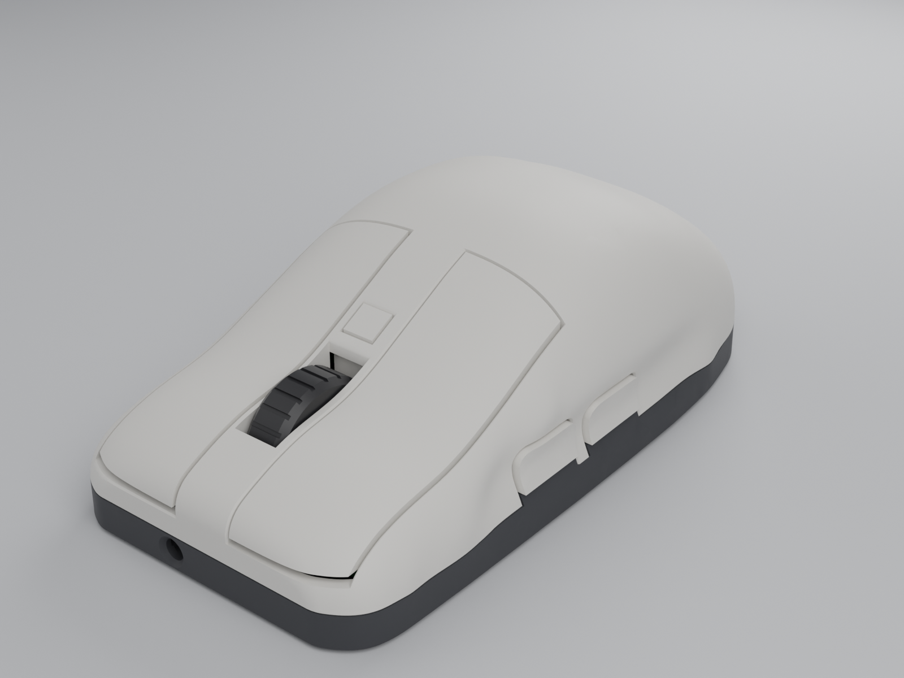

# build123d · Claude Code çoklu ajan

Aynı `girdi/mouse_pcb.step` kartı için fare kabuğu. NX yok, tamamen Python: **build123d 0.11.1** (OpenCascade).
Claude Code (Opus 5.5, ultracode modu) işi paketlere bölüp alt ajanlara dağıttı:

1. kart okuma
2. datasheet ve kural araştırması
3. ortak yerleşim (`src/02_master/master.py`)
4. 5 parça paketi paralel
5. montaj ve çakışma kontrolü
6. bağımsız baş mühendis incelemesi
7. bir düzeltme turu
8. teslim ve Blender render

Kart kendi STEP koordinatında, yerinden oynatılmadı (+Y ön, +X sağ, +Z yukarı, masa Z -5.85).

**Süre:** yaklaşık 4 sa 45 dk duvar saati (25 Kasım 21.07 → 26 Kasım 01.51), bekleme ve yönlendirme dahil.

**Durum: teslim edildi, baskıya hazır değil.** Bağımsız incelemede 6 engelleyici bulgu açık kaldı. Bunların en önemlisi şu: ana tuşların üst kabuğa takılabildiği ispatlanamadı. Hepsinin ayrıntısı aşağıda ve [`CHECKS.md`](CHECKS.md) içinde.

## Dosyalar

| Dosya / klasör | İçerik |
|---|---|
| `mouse_assembly_step.zip` | `mouse_assembly.step`: orijinal PCB (69 katı, yerinde) + 10 parça, adlandırılmış ve renkli (açılmış hali 130 MB) |
| `parts_step.zip` | `STEP/<parça>.step`: her parça montaj konumunda |
| [`STL/`](STL/) | Parça başına STL, **baskı yönünde** (tabla Z 0) |
| [`renders/`](renders/) | hero, üst, yan, alt, patlatılmış, kesit (Blender 5.1 Cycles) |
| [`CHECKS.md`](CHECKS.md) | Ölçülen kabul tablosu (A1..A25), çakışma, hareket ve basılabilirlik sonuçları |
| [`src/`](src/) | Modeli üreten betikler: `00_pcb` kart okuma, `01_research/CONSTRAINTS.md`, `02_master` ortak yerleşim + tasarım şartnamesi, `03_parts/<parça>/build_*.py`, `04_asm` montaj + çakışma, `05_review` inceleme |

## Parçalar ve baskı

| Parça | Malzeme | Baskı yönü | Destek |
|---|---|---|---|
| bottom_shell | PLA/PETG koyu | alt yüz tablada | yok |
| top_shell | PLA | kenar tablada, kubbe yukarı | yalnız içeride ağaç destek |
| button_L / button_R | PETG | parmak yüzü yukarı | panel altına ağaç destek, brim |
| wheel_body | PLA | eksen dikey | yok |
| wheel_yoke | PETG | yan yüz tablada | yok |
| dpi_button | PLA | takıldığı gibi | yok, brim |
| side_btn_fwd / side_btn_back | PETG | STL yönünde | gerekli (düz tabla teması yok) |

Satın alınacak parçalar:

- 4 × M2×6 sac vidası (kart → alt kabuk)
- 3 × M2×8 vida + 3 × M2×3 ısıyla gömme insert (alt → üst kabuk)
- 2 × M2×6 (tuş yaprakları)
- Ø2×16 çelik pim (tekerlek aksı)
- PTFE ayak (0.8 mm)
- USB kablo (≤ Ø3.5, lehimli)

## Ölçülen ana değerler

- **Dış ölçü:** 120.0 × 63.5 × 39.9 mm (sağ el, başparmak oluğu solda)
- **Sensör:** lens düzlemi masadan 2.40 mm yukarıda (datasheet 2.2–2.6)
- **Ana tuşlar:** nub–plunger boşluğu 0.10, plunger stroku 0.68, sert stop kartta
- **Tekerlek:** Ø23.6, üst kabuktan 3.14 çıkıntılı; orta tık stroku 0.67; eğik durumda kabuğa 0.303 boşluk
- **Yan tuşlar:** dirsekli kol (başparmak itişi → aşağı basış), stop 5.15°, stroku 0.78–0.81

## Açık bulgular (engelleyici)

1. **Ana tuşlar:** düz takma yollarının hepsinde üst kabuğa çarpıyor. Önerilen çözüm: yaprağı ayrı PETG şerit yapıp tuşa alttan vidalamak.
2. **Arka ayak yuvası:** tavanı 11 mm köprü (sınır 10).
3. **Üst kabuk yan çentikleri:** tepeleri dışta 13 mm düz köprü.
4. **Yan tuş kolları:** düz tabla teması yok.
5. **Üst kabuk tuş ayrım çizgileri:** ince kenar kalıyor (duvar < 1.6).
6. **Vida havşası:** Ø4.4, kabuldeki Ø4.5 takım yolu ile çelişiyor.

Varsayımlar:

- D2F, PMW3360 ve EC10E yükseklikleri STEP'te tahmini (yer tutucu). Gerçek parçalarla nub boşluklarını ilk baskıda kontrol edin.
- Kart STEP'te 1.51 mm, görevde 1.6 mm. 1.6 mm kartta ana tuş stroku 0.71 olur.

Betiklerdeki mutlak Windows yolları bizim makinemize ait; kendi makinenizde değiştirin. `master.py` ilk çalıştırmada dış kabuğu yaklaşık 110 s'de kurar, sonra önbellekten okur.
